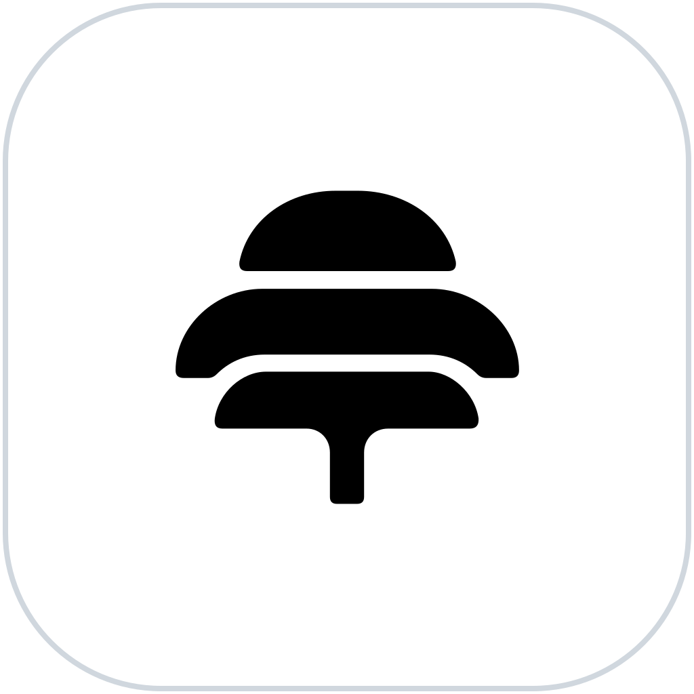
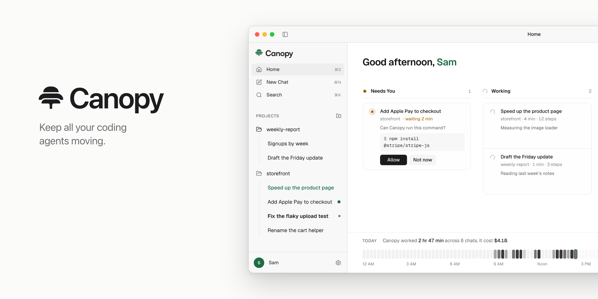

<p align="center">
  <picture>
    <source media="(prefers-color-scheme: dark)" srcset=".github/readme/icon-dark.svg">
    
  </picture>
</p>

<h1 align="center">Canopy</h1>

<p align="center">
  <b>Keep all your coding agents moving.</b><br>
  Canopy runs on the Claude Code and Codex you already have.
</p>

<p align="center">
  <a href="#install">Install</a> ·
  <a href="#privacy">Privacy</a> ·
  <a href="#development">Development</a> ·
  <a href="CONTRIBUTING.md">Contributing</a>
</p>

<p align="center">
  <picture>
    <source media="(prefers-color-scheme: dark)" srcset=".github/readme/hero-dark.png">
    
  </picture>
</p>

Canopy runs the Claude Code and Codex already on your Mac, in one window. It uses their setup as it is: your settings, skills, plugins, MCP servers and sign-ins. Chats stay in each tool's own files, so one you start in Canopy carries on in the terminal, and one you start in the terminal shows up in Canopy.

It is free and open source, and it comes with no usage of its own. You bring a Claude or ChatGPT plan, or an API key.

## What you get

- **Every chat keeps working.** Start as many as you like. Home sorts them into Needs you, Working and Done today, and a notification tells you when one finishes or has a question.
- **Up to four side by side.** Multi mode puts chats next to each other, each with its own message box.
- **Claude and OpenAI models in one menu.** Pick a model for each chat. A chat can move to the other maker and carry on from a summary of where it was.
- **No upkeep.** Canopy installs Claude Code and Codex if they are missing, using their makers' own installers. It keeps them up to date and picks up new models when they ship.
- **Accounts and usage in view.** See which sign-in a chat runs on, how much of your plan's limit is used, and what a pay-per-use key has spent.
- **Answers you can look at.** Tables, charts, diffs and mockups are drawn in the chat.
- **You decide what runs.** Choose how much a chat may do without asking, from approving every edit to full access. Changes lists every file it touched.

## Install

You need:

- A Mac on macOS 13 or later (Apple silicon or Intel).
- Claude Code, Codex, or both. Canopy installs whichever is missing.
- A Claude or ChatGPT plan, or an API key from Anthropic or OpenAI.

Then:

1. [Download Canopy](https://github.com/KrishVazirani18/canopy/releases/latest/download/Canopy.dmg) and open it.
2. Drag Canopy into Applications.
3. Open Canopy. It is signed and notarized by Apple, so it opens like any other app.

Canopy keeps itself up to date: it downloads new versions in the background and asks you to restart when one is ready.

### Run from source

This works today. You need a Mac and [Node.js](https://nodejs.org) 26 or later.

```sh
git clone https://github.com/KrishVazirani18/canopy.git
cd canopy
npm install
npm start
```

`npm start` builds the interface and opens Canopy. The first start also downloads Electron, so give it a minute. While Canopy runs, edits to the interface show up as you save them.

## Signing in

Canopy asks you to sign in to two different things.

- **Your Canopy account.** The download asks you to sign in with Google once. It tells the project who is using Canopy: your name, email and photo from Google, the version of Canopy you run, and when you signed up and last opened it. Nothing else is kept with it, and Settings can delete it. A copy built from source skips this step.
- **Claude Code and Codex.** You sign in to each through its own sign-in, the same one you would use in the terminal. Canopy never reads or stores those logins. If you add an Anthropic or OpenAI API key instead, it is kept encrypted on your Mac and sent only to its maker.

## Privacy

Your chats stay on your Mac. There is no Canopy server between you and Claude Code or Codex.

Canopy shares usage stats so it can get better. They are counts, never content.

- **Sent:** which parts of Canopy you use, the models and versions you run, how long replies take, the first line of an error, and how many messages you send each day in Claude Code and Codex, in Canopy and outside it. Each batch carries a random ID for this Mac, and a name only if you add one.
- **Never sent:** what you write, what Claude or Codex reply, your code and files, or the names of your files, folders, projects and chats.

To turn stats off, open Settings and switch off **Share usage stats**, or set `CANOPY_TELEMETRY=0` in the environment Canopy starts in. Settings also shows every event exactly as it is sent. A copy built from source sends nothing.

Everything Canopy may send is listed in one file, [src/telemetry/schema.mjs](src/telemetry/schema.mjs). Anything that is not on that list is dropped before it leaves. Stats go to PostHog. Your Canopy account is kept with Supabase.

## Development

After the steps in [Run from source](#run-from-source), these are the checks every change has to pass:

```sh
npm run typecheck   # the interface's types
npm test            # unit tests: no Claude Code, Codex or network needed
npm run build:ui    # the interface, built into dist-ui/
```

`npm run build:app` builds Canopy.app and `npm run build:dmg` the DMG; [docs/RELEASING.md](docs/RELEASING.md) covers releases. [CONTRIBUTING.md](CONTRIBUTING.md) has the rest: a map of the code, the interface harness and the checks that talk to the real tools.

## Contributing

Bug reports and pull requests are welcome. [CONTRIBUTING.md](CONTRIBUTING.md) has the setup, a map of the code and what a good pull request looks like. To report a security problem, follow [SECURITY.md](SECURITY.md) instead of opening an issue.

## License

Canopy's own code is under the [MIT License](LICENSE). It runs Claude Code through the Claude Agent SDK, which is Anthropic's software under Anthropic's own terms and is not covered by that license.

Not affiliated with Anthropic or OpenAI. Canopy is an independent project, and neither company endorses or sponsors it. Claude and Claude Code are trademarks of Anthropic. Codex and ChatGPT are trademarks of OpenAI.
